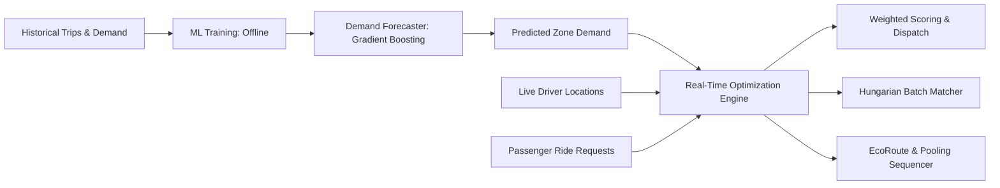
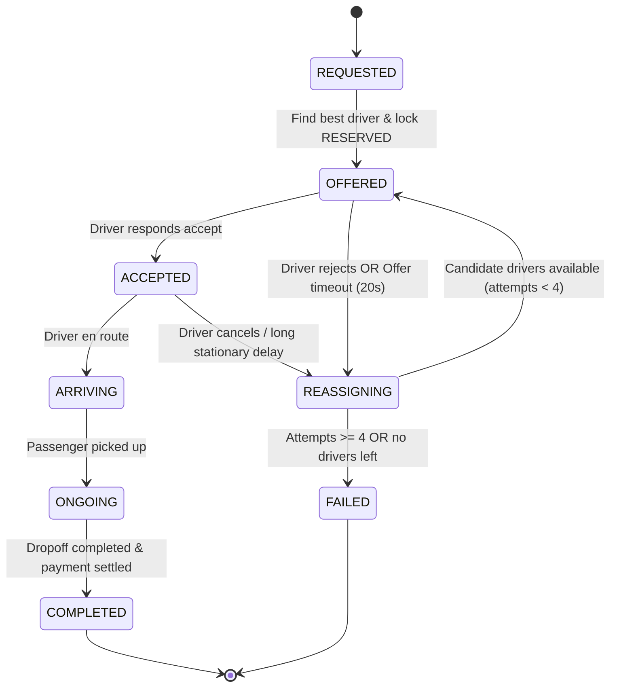

# RideSync AI — Algorithm & Optimization Plan

This document details the mathematical formulation, algorithmic approaches, and architectural boundaries for the core AI and optimization components of RideSync AI.

---

## Architecture Boundary: ML vs Deterministic Optimization

- **Machine Learning (Predictive)**: Demand forecasting, pickup hot-spot prediction, estimated arrival duration regression. Evaluated statistically against chronological holdouts.
- **Deterministic Optimization (Prescriptive)**: Driver-to-ride allocation, Dijkstra/A* routing, multi-passenger pickup/drop-off permutations, state machine reassignment. Enforces hard operational constraints.

---

## 1. Predictive Demand Forecasting (Gradient Boosting)

### Objective
Predict hourly ride request volumes for each of the Belagavi operational zones ($Z_1 \dots Z_8$) 1 to 24 hours in advance.

### Features
- Temporal: `hour` (0–23), `day_of_week` (0–6), `is_weekend` (0/1), cyclical encoding ($\sin/\cos$ of hour & day).
- Spatial: `zone_code`, historical zone density category.
- Lags & Rolling: $t-1, t-2, t-24$ request counts, 3-hour and 6-hour rolling mean/std.

### Model & Validation
- **Algorithm**: Gradient Boosting Regressor (LightGBM / scikit-learn `HistGradientBoostingRegressor`).
- **Validation Scheme**: Chronological train/validation split (first 21 days training, subsequent 7 days testing). **No random K-Fold** to prevent temporal data leakage.
- **Evaluation Metrics**:
  $$\text{MAE} = \frac{1}{N}\sum |y_i - \hat{y}_i|$$
  $$\text{RMSE} = \sqrt{\frac{1}{N}\sum (y_i - \hat{y}_i)^2}$$
  Must strictly outperform a baseline rolling time-of-day average.

---

## 2. Zone Intelligence & Dynamic Surge Multiplier

### Supply-Demand Ratio
For each zone $z$ at current time $t$:
$$R_z = \frac{\text{Active Requests}_z + \alpha \cdot \widehat{\text{Demand}}_{z, t+1}}{\text{Available Drivers}_z + \epsilon}$$

### Dynamic Pricing
$$\text{Surge Multiplier } S_z = \min\left(S_{\max}, \max\left(1.0, 1.0 + \beta \cdot \max(0, R_z - 1.0)\right)\right)$$
Where $S_{\max} = 2.5$, $\beta = 0.3$, and base surge is capped to maintain regulatory compliance.

### Driver Repositioning Advisory
Zones with $R_z > 1.5$ and nearby zones with $R_{z'} < 0.6$ trigger idle driver repositioning recommendations with estimated incentives.

---

## 3. Road Network Routing (A* & Dijkstra)

### Graph Representation
- Built using **OSMnx** from Belagavi OpenStreetMap road network.
- Nodes: Intersections and road endpoints (coordinates snapped to nearest graph node).
- Directed Edges: Road segments with attributes: `length_meters`, `maxspeed`, `highway_type`, `surface`.

### Objective Function
For path $P = (e_1, e_2, \dots, e_k)$:
- **Shortest Route**: $\min \sum \text{length}(e_i)$
- **Fastest Route**: $\min \sum \frac{\text{length}(e_i)}{\text{speed}(e_i)}$
- **EcoRoute**: $\min \sum \text{FuelConsumption}(e_i, \text{speed}(e_i), \text{incline})$

---

## 4. Fuel & Emission Estimation (EcoDispatch)

### Fuel Model Assumptions
Fuel consumption rate $C$ (liters per 100 km) modelled as a function of average road speed $v$ (km/h) and vehicle classification:
- **Auto-rickshaw**: Base $3.8 \text{ L}/100\text{km}$ (CNG/Petrol equivalent)
- **Hatchback / Sedan**: Base $6.5 \text{ L}/100\text{km}$
- **Motorcycle / EV**: Documented separately; EV computes $\text{kWh}/100\text{km}$.

$$\text{Fuel}(L) = \frac{\text{distance\_km}}{100} \times \text{BaseRate} \times \phi(\text{speed})$$
Where speed penalty factor $\phi(v) = 1.0 + 0.0008 \times (v - 45)^2$ penalizes severe stop-and-go and high-speed drag.

$$\text{CO}_2 \text{ Saved (kg)} = \Delta \text{Fuel (L)} \times 2.31 \text{ kg CO}_2/\text{L (petrol)}$$

---

## 5. Intelligent Driver Allocation (Single Request)

When a ride is requested, eligible available drivers within radius $R_{\max} = 5.0\text{ km}$ are ranked by an explainable multi-factor score:

$$\text{Score}(d, r) = w_1 \cdot \text{ProximityScore} + w_2 \cdot \text{ETA} + w_3 \cdot \text{AcceptanceRate} + w_4 \cdot \text{IdleFairness} - w_5 \cdot \text{FuelPenalty}$$

### Weights ($w_i \ge 0, \sum w_i = 1.0$):
- $w_1 = 0.35$ (Distance to pickup)
- $w_2 = 0.25$ (Estimated pickup time)
- $w_3 = 0.15$ (Driver reliability & acceptance history)
- $w_4 = 0.15$ (Idle queue time to ensure driver earning fairness)
- $w_5 = 0.10$ (EcoDispatch empty deadhead fuel cost)

---

## 6. Hungarian Algorithm (Batch Matcher)

For batch intervals (e.g., matching rides pooled in 10-second windows during high demand):
- Cost matrix $C_{i,j}$ where row $i$ is ride request, column $j$ is candidate driver.
- $C_{i, j} = 100 - \text{Score}(d_j, r_i)$ if driver is reachable, else $\infty$.
- Solved in $O(N^3)$ via Munkres/Hungarian algorithm to globally minimize aggregate passenger waiting time and empty cruising miles.

---

## 7. Multi-Passenger Ride Pooling Heuristic

### Feasibility Constraints
1. Vehicle remaining capacity: $\sum \text{passengers} \le \text{Capacity}_{\max}$.
2. Detour constraint: For every passenger $p$, actual arrival time $\le \text{DirectArrival}_p \times 1.30 + 5\text{ min}$.
3. Directional compatibility: Dot product of request displacement vectors $\vec{v}_1 \cdot \vec{v}_2 > 0.5$.

### Insertion & Sequencing
For a confirmed ride with stops $(P_1, D_1)$ and a new request $(P_2, D_2)$:
- Evaluate permissible permutations of valid orders preserving $P_i$ before $D_i$:
  1. $P_1 \to P_2 \to D_1 \to D_2$
  2. $P_1 \to P_2 \to D_2 \to D_1$
  3. $P_1 \to D_1 \to P_2 \to D_2$ (sequential fallback)
- Pick permutation minimizing total marginal road distance and passenger delay.

---

## 8. Automatic Reassignment State Machine

