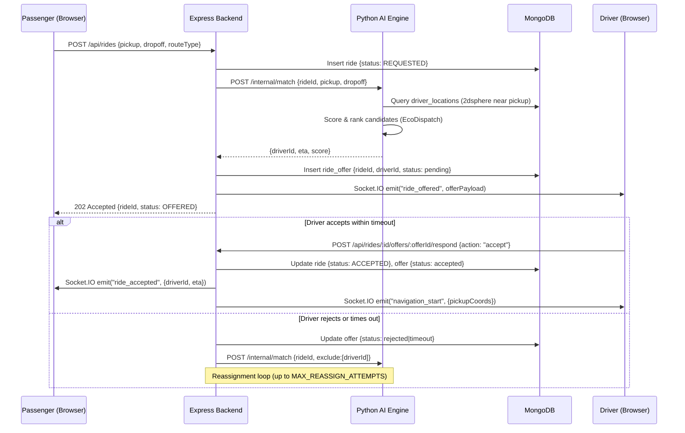

# RideSync AI — System Architecture

> **Version:** 1.0  
> **Status:** Proposed / In Development  
> **Last Updated:** 2026-11-13

---

## 1. High-Level Overview

RideSync AI is composed of four runtime tiers that communicate over HTTP REST and WebSocket channels:

| Tier | Technology | Responsibility |
|------|------------|----------------|
| **Frontend** | React 18, Leaflet, Three.js | Passenger, Driver, and Admin UIs |
| **Backend** | Node.js 20, Express 5, Socket.IO | REST API, auth, real-time events, ride state machine |
| **AI Engine** | Python 3.11, FastAPI, scikit-learn, OSMnx | Demand prediction, routing, matching, fuel modelling |
| **Database** | MongoDB 7 (Atlas or self-hosted) | All persistent state; 13 collections |

---

## 2. Component Map

```
┌────────────────────────────────────────────────────────────────┐
│                        React Frontend                          │
│  ┌──────────────┐  ┌──────────────┐  ┌──────────────────────┐ │
│  │  Passenger   │  │   Driver     │  │  Admin / CityLab     │ │
│  │  App         │  │  Dashboard   │  │  Simulation Panel    │ │
│  └──────┬───────┘  └──────┬───────┘  └──────────┬───────────┘ │
└─────────┼─────────────────┼─────────────────────┼─────────────┘
          │  REST + WS      │  REST + WS           │  REST
          ▼                 ▼                       ▼
┌────────────────────────────────────────────────────────────────┐
│                   Express Backend (Node.js)                     │
│                                                                 │
│  ┌──────────────┐  ┌──────────────┐  ┌──────────────────────┐  │
│  │  Auth        │  │  Rides &     │  │  Admin &             │  │
│  │  Middleware  │  │  Dispatch    │  │  Analytics Routes    │  │
│  │  (JWT)       │  │  Routes      │  │                      │  │
│  └──────────────┘  └──────┬───────┘  └──────────────────────┘  │
│                           │                                     │
│  ┌────────────────────────▼────────────────────────────────┐   │
│  │                 Socket.IO Server                         │   │
│  │   Events: ride_offered, ride_accepted, driver_location,  │   │
│  │           ride_status_changed, surge_updated             │   │
│  └──────────────────────────────────────────────────────────┘   │
└──────────────────────────┬──────────────────────────────────────┘
                           │  HTTP (internal)
                           ▼
┌────────────────────────────────────────────────────────────────┐
│                   Python AI Engine (FastAPI)                    │
│                                                                 │
│  ┌────────────────┐  ┌────────────────┐  ┌──────────────────┐  │
│  │  EcoDispatch   │  │   EcoRoute     │  │  Fuel Dashboard  │  │
│  │  (Matching &   │  │  (Routing:     │  │  (Consumption    │  │
│  │   Demand)      │  │  OSMnx/NX)    │  │   Model)         │  │
│  └────────────────┘  └────────────────┘  └──────────────────┘  │
│                                                                 │
│  ┌────────────────────────────────────────────────────────┐    │
│  │                 CityLab Simulation Engine               │    │
│  │   Runs batch simulations; writes to simulation_runs     │    │
│  └────────────────────────────────────────────────────────┘    │
└──────────────────────────┬──────────────────────────────────────┘
                           │  Mongoose ODM
                           ▼
┌────────────────────────────────────────────────────────────────┐
│                        MongoDB                                  │
│   users · drivers · rides · ride_offers · ride_events          │
│   zones · demand_history · demand_predictions                  │
│   driver_activity · driver_locations · ride_pools              │
│   zone_pricing · simulation_runs                               │
└────────────────────────────────────────────────────────────────┘
```

---

## 3. Request Flow — Passenger Books a Ride



---

## 4. AI Engine — Sub-Components

### 4.1 EcoDispatch AI

**Responsibility:** Select the optimal driver for a given ride request.

**Inputs:**
- Ride pickup coordinates
- Candidate driver list (from `driver_locations`)
- Each driver's current workload metrics (from `driver_activity`)

**Outputs:**
- Ranked driver list with scores
- Estimated pickup ETA per driver

**Algorithm:** Weighted multi-criteria scoring (see `ALGORITHM_PLAN.md §5`). For large batches, the Hungarian algorithm is applied (see `§6`).

---

### 4.2 EcoRoute

**Responsibility:** Compute and compare multiple routes between two points on the Belagavi road network.

**Inputs:**
- Origin coordinates (lng, lat)
- Destination coordinates (lng, lat)
- Route preference (`fastest` | `shortest` | `eco`)

**Outputs:**
- Ordered list of waypoints
- Total distance (km), estimated duration (min), estimated fuel consumption (L)

**Technology:** OSMnx to load the city graph from OpenStreetMap; NetworkX for Dijkstra / A* traversal.

---

### 4.3 Demand Prediction (Gradient Boosting)

**Responsibility:** Forecast per-zone ride demand for the next 1–24 hours.

**Inputs:**
- Historical `demand_history` records
- Time-of-day, day-of-week, weather features, local event flags

**Outputs:**
- `demand_predictions` documents: zone_id → predicted_count for each future time-slot

**Technology:** scikit-learn `GradientBoostingRegressor`; trained offline, served via FastAPI endpoint.

---

### 4.4 Fuel Dashboard Model

**Responsibility:** Estimate fuel consumption for a given route and vehicle type.

**Inputs:**
- Route distance (km)
- Vehicle type (`auto` | `bike` | `sedan` | `suv`)

**Outputs:**
- Estimated litres consumed
- Estimated CO₂ equivalent (kg)

**Model:** Lookup table of average L/100 km per vehicle type (documented assumptions; see `ALGORITHM_PLAN.md §4`).

---

### 4.5 CityLab Simulation Engine

**Responsibility:** Run configurable fleet dispatch simulations for administrative scenario planning.

**Inputs:**
- Scenario parameters (fleet size, demand multiplier, time window, dispatch policy)
- Historical demand data

**Outputs:**
- Simulated KPIs: average wait time, revenue, utilisation rate, CO₂ total
- Stored in `simulation_runs` collection

---

## 5. Real-Time Layer — Socket.IO

| Event Name | Direction | Payload |
|-----------|-----------|---------|
| `ride_offered` | Server → Driver | `{rideId, offerId, pickup, dropoff, estimatedEarnings, timeoutSeconds}` |
| `ride_accepted` | Server → Passenger | `{rideId, driverId, driverName, eta, driverLocation}` |
| `driver_location` | Server → Passenger | `{rideId, coords: [lng, lat], eta}` |
| `ride_status_changed` | Server → Both | `{rideId, newStatus, timestamp}` |
| `surge_updated` | Server → Passenger | `{zoneId, multiplier}` |
| `offer_timeout` | Server → Driver | `{offerId}` |

---

## 6. Authentication & Security

- **JWT** (HS256) issued at login; `15 min` access token + `7 day` refresh token.
- Role field in JWT payload: `passenger` | `driver` | `admin`.
- Express middleware validates token on every protected route.
- Sensitive config (MongoDB URI, JWT secret) stored in `.env`; never committed.

---

## 7. Deployment Topology (MVP)

```
┌──────────────────┐    ┌──────────────────┐    ┌──────────────────┐
│   React SPA      │    │  Express API     │    │  Python FastAPI  │
│  (Vite dev or    │    │  :3001           │    │  :8000           │
│   static build)  │◄──►│  + Socket.IO     │◄──►│                  │
│  :5173           │    │                  │    │                  │
└──────────────────┘    └────────┬─────────┘    └──────────────────┘
                                 │
                                 ▼
                        ┌──────────────────┐
                        │   MongoDB        │
                        │  :27017 (local)  │
                        │  or Atlas URI    │
                        └──────────────────┘
```

All services run locally during development. Environment variables control connection strings.

---

## 8. Directory Structure (Proposed)

```
RideSync-AI/
├── backend/                  # Node.js / Express
│   ├── models/               # Mongoose schemas
│   ├── routes/               # Express routers
│   ├── middleware/           # Auth, error handling
│   ├── services/             # Ride state machine, dispatch, Socket.IO
│   └── server.js
├── frontend/                 # React (Vite)
│   ├── src/
│   │   ├── pages/            # Passenger, Driver, Admin pages
│   │   ├── components/       # Shared UI components
│   │   └── hooks/            # useSocket, useRide, etc.
│   └── index.html
├── ai-engine/                # Python / FastAPI
│   ├── models/               # Trained .pkl files (not committed if large)
│   ├── routers/              # FastAPI route handlers
│   ├── services/             # Demand, routing, matching, fuel logic
│   └── main.py
├── docs/                     # This documentation layer
│   ├── PROJECT_SPEC.md
│   ├── ARCHITECTURE.md
│   ├── DATABASE_SCHEMA.md
│   ├── API_CONTRACTS.md
│   ├── ALGORITHM_PLAN.md
│   ├── TEAM_TASKS.md
│   └── TEST_PLAN.md
├── ridesync-belagavi-starter/ # Reference starter — DO NOT DELETE
├── AGENTS.md
└── README.md
```
