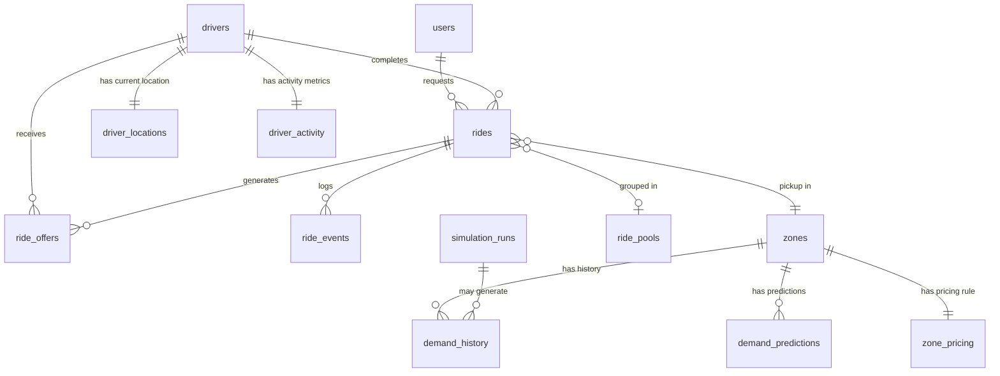

# RideSync AI — Database Schema

> **Version:** 1.0  
> **Status:** PROPOSED — No models are implemented yet. This document describes the intended schema design.  
> **Last Updated:** 2026-11-13  
> **Database:** MongoDB 7  
> **ODM:** Mongoose (Node.js backend)

> **Implementation addendum (2026-11-14):** The sections below include the
> original proposed schema. Runtime models are in `backend/src/models/index.js`;
> the implemented `users` and `drivers` shapes described at the end supersede
> older proposed field names where they differ.

All GeoJSON coordinates follow the **[longitude, latitude]** order per the GeoJSON spec and MongoDB's `2dsphere` index requirement.

---

## Collection Index

1. [users](#1-users)
2. [drivers](#2-drivers)
3. [rides](#3-rides)
4. [ride_offers](#4-ride_offers)
5. [ride_events](#5-ride_events)
6. [zones](#6-zones)
7. [demand_history](#7-demand_history)
8. [demand_predictions](#8-demand_predictions)
9. [driver_activity](#9-driver_activity)
10. [driver_locations](#10-driver_locations)
11. [ride_pools](#11-ride_pools)
12. [zone_pricing](#12-zone_pricing)
13. [simulation_runs](#13-simulation_runs)

---

## 1. `users`

Stores all registered passengers.

### Fields

| Field | Type | Required | Description |
|-------|------|----------|-------------|
| `_id` | ObjectId | ✓ | Auto-generated primary key |
| `name` | String | ✓ | Full display name |
| `email` | String | ✓ | Unique; used for login |
| `phone` | String | ✓ | Unique E.164 format |
| `passwordHash` | String | ✓ | bcrypt hash; never expose in API |
| `role` | String | ✓ | Enum: `"passenger"` (always for this collection) |
| `rating` | Number | — | Average driver rating received; 1–5 |
| `totalRides` | Number | — | Cumulative ride count |
| `createdAt` | Date | ✓ | ISO 8601 |
| `updatedAt` | Date | ✓ | ISO 8601 |

### Indexes

```js
{ email: 1 }          // unique
{ phone: 1 }          // unique
```

### Relationships

- Referenced by `rides.passengerId`
- Referenced by `ride_events.actorId` (when actor is passenger)

---

## 2. `drivers`

Stores all registered and admin-approved drivers.

### Fields

| Field | Type | Required | Description |
|-------|------|----------|-------------|
| `_id` | ObjectId | ✓ | Auto-generated primary key |
| `name` | String | ✓ | Full display name |
| `email` | String | ✓ | Unique |
| `phone` | String | ✓ | Unique E.164 format |
| `passwordHash` | String | ✓ | bcrypt hash |
| `role` | String | ✓ | Enum: `"driver"` |
| `vehicleType` | String | ✓ | Enum: `"auto"` \| `"bike"` \| `"sedan"` \| `"suv"` |
| `licencePlate` | String | ✓ | Unique |
| `available` | Boolean | ✓ | Whether actively accepting rides |
| `approved` | Boolean | ✓ | Admin-approved flag |
| `rating` | Number | — | Average passenger rating received; 1–5 |
| `acceptanceRate` | Number | — | Fraction of offers accepted; 0.0–1.0 |
| `totalRides` | Number | — | Cumulative completed rides |
| `createdAt` | Date | ✓ | |
| `updatedAt` | Date | ✓ | |

### Indexes

```js
{ email: 1 }          // unique
{ phone: 1 }          // unique
{ licencePlate: 1 }   // unique
{ available: 1 }      // filter available drivers quickly
```

### Relationships

- Referenced by `rides.driverId`
- Referenced by `ride_offers.driverId`
- Referenced by `driver_locations.driverId` (1-to-1 current snapshot)
- Referenced by `driver_activity.driverId`

---

## 3. `rides`

Central ride record — the source of truth for ride state.

The implemented live ride model also stores `pickupAddress`, `dropoffAddress`, and `cancellationReason` so a selected geocoded label and cancellation audit detail survive refreshes. Driver GPS is stored on the driver document's GeoJSON `location` with `lastLocationAt`; the existing `2dsphere` index supports matching.

### Fields

| Field | Type | Required | Description |
|-------|------|----------|-------------|
| `_id` | ObjectId | ✓ | |
| `passengerId` | ObjectId | ✓ | Ref: `users._id` |
| `driverId` | ObjectId | — | Ref: `drivers._id`; set on ACCEPTED |
| `poolId` | ObjectId | — | Ref: `ride_pools._id`; set if pooled |
| `status` | String | ✓ | Enum: `REQUESTED` \| `OFFERED` \| `ACCEPTED` \| `ARRIVING` \| `ONGOING` \| `COMPLETED` \| `CANCELLED` \| `FAILED` \| `REASSIGNING` |
| `pickup` | GeoJSON Point | ✓ | `{type:"Point", coordinates:[lng,lat]}` |
| `dropoff` | GeoJSON Point | ✓ | `{type:"Point", coordinates:[lng,lat]}` |
| `pickupAddress` | String | — | Human-readable |
| `dropoffAddress` | String | — | Human-readable |
| `routeType` | String | ✓ | Enum: `"fastest"` \| `"shortest"` \| `"eco"` |
| `routeWaypoints` | Array\<[lng,lat]\> | — | Ordered coordinate list from AI engine |
| `estimatedDistanceKm` | Number | — | |
| `estimatedDurationMin` | Number | — | |
| `estimatedFuelL` | Number | — | From Fuel Dashboard model |
| `fareEstimate` | Number | — | In INR; computed at REQUESTED |
| `fareFinal` | Number | — | In INR; computed at COMPLETED |
| `surgeMultiplier` | Number | — | Snapshot at booking time; default 1.0 |
| `zoneId` | ObjectId | — | Ref: `zones._id`; pickup zone |
| `reassignCount` | Number | ✓ | Default 0; increments each reassign |
| `cancelledBy` | String | — | Enum: `"passenger"` \| `"system"` |
| `cancelledAt` | Date | — | |
| `completedAt` | Date | — | |
| `createdAt` | Date | ✓ | |
| `updatedAt` | Date | ✓ | |

### Indexes

```js
{ passengerId: 1, createdAt: -1 }
{ driverId: 1, status: 1 }
{ status: 1 }
{ "pickup": "2dsphere" }
{ "dropoff": "2dsphere" }
```

### Relationships

- Parent of `ride_offers` (1-to-many)
- Parent of `ride_events` (1-to-many)
- May belong to `ride_pools`

---

## 4. `ride_offers`

Each attempt to dispatch a driver for a ride generates one offer record.

### Fields

| Field | Type | Required | Description |
|-------|------|----------|-------------|
| `_id` | ObjectId | ✓ | |
| `rideId` | ObjectId | ✓ | Ref: `rides._id` |
| `driverId` | ObjectId | ✓ | Ref: `drivers._id` |
| `status` | String | ✓ | Enum: `"pending"` \| `"accepted"` \| `"rejected"` \| `"timeout"` \| `"superseded"` |
| `attemptNumber` | Number | ✓ | 1-based; increments on each reassign |
| `offeredAt` | Date | ✓ | When the offer was sent |
| `respondedAt` | Date | — | When driver acted (or timeout fired) |
| `timeoutSeconds` | Number | ✓ | Snapshot of config at offer time |
| `driverScoreAtOffer` | Number | — | EcoDispatch score snapshot |
| `etaMinutes` | Number | — | Predicted pickup ETA |
| `createdAt` | Date | ✓ | |

### Indexes

```js
{ rideId: 1, attemptNumber: 1 }
{ driverId: 1, status: 1 }
{ offeredAt: 1 }  // TTL candidate for cleanup
```

### Relationships

- Belongs to one `rides` document
- References one `drivers` document

---

## 5. `ride_events`

Immutable audit log of every significant state change in a ride's lifecycle.

### Fields

| Field | Type | Required | Description |
|-------|------|----------|-------------|
| `_id` | ObjectId | ✓ | |
| `rideId` | ObjectId | ✓ | Ref: `rides._id` |
| `eventType` | String | ✓ | Enum: `"status_change"` \| `"offer_sent"` \| `"offer_response"` \| `"location_snapshot"` \| `"fare_calculated"` \| `"cancellation"` |
| `fromStatus` | String | — | Previous ride status |
| `toStatus` | String | — | New ride status |
| `actorId` | ObjectId | — | User or Driver who triggered the event |
| `actorRole` | String | — | Enum: `"passenger"` \| `"driver"` \| `"system"` |
| `metadata` | Object | — | Freeform extra context (e.g., reason, location) |
| `occurredAt` | Date | ✓ | |

### Indexes

```js
{ rideId: 1, occurredAt: 1 }
{ eventType: 1 }
```

### Notes

This collection is append-only. No documents should ever be updated or deleted (except by a data retention policy).

---

## 6. `zones`

Geographic zones used for demand prediction, surge pricing, and heat maps.

### Fields

| Field | Type | Required | Description |
|-------|------|----------|-------------|
| `_id` | ObjectId | ✓ | |
| `name` | String | ✓ | Human-readable zone label (e.g., "Central Belagavi") |
| `code` | String | ✓ | Unique short code (e.g., `"BLG-C01"`) |
| `boundary` | GeoJSON Polygon | ✓ | `{type:"Polygon", coordinates:[[[lng,lat],...]]}` |
| `centroid` | GeoJSON Point | — | Centroid for quick distance queries |
| `city` | String | ✓ | e.g., `"Belagavi"` |
| `active` | Boolean | ✓ | Whether zone is currently used |
| `createdAt` | Date | ✓ | |

### Indexes

```js
{ code: 1 }          // unique
{ boundary: "2dsphere" }
{ centroid: "2dsphere" }
```

### Relationships

- Referenced by `rides.zoneId`
- Referenced by `demand_history.zoneId`
- Referenced by `demand_predictions.zoneId`
- Referenced by `zone_pricing.zoneId`

---

## 7. `demand_history`

Historical records of observed ride demand per zone per time slot. Used as ML training data.

### Fields

| Field | Type | Required | Description |
|-------|------|----------|-------------|
| `_id` | ObjectId | ✓ | |
| `zoneId` | ObjectId | ✓ | Ref: `zones._id` |
| `slotStart` | Date | ✓ | Start of the 30-minute demand slot (UTC) |
| `slotEnd` | Date | ✓ | End of the 30-minute slot |
| `rideCount` | Number | ✓ | Observed ride requests in this slot |
| `completedCount` | Number | — | Rides that reached COMPLETED |
| `cancelledCount` | Number | — | Rides cancelled in this slot |
| `avgWaitTimeMin` | Number | — | Average time from REQUESTED to ACCEPTED |
| `isSynthetic` | Boolean | ✓ | **True if data is simulated/synthetic** |
| `sourceRunId` | ObjectId | — | Ref: `simulation_runs._id`; set if synthetic |
| `createdAt` | Date | ✓ | |

### Indexes

```js
{ zoneId: 1, slotStart: 1 }   // compound, unique
{ slotStart: -1 }
```

> [!IMPORTANT]
> All synthetic records **must** have `isSynthetic: true`. Never mix synthetic and real data in model training without explicit flagging.

---

## 8. `demand_predictions`

AI engine outputs — forecast demand per zone per future time slot.

### Fields

| Field | Type | Required | Description |
|-------|------|----------|-------------|
| `_id` | ObjectId | ✓ | |
| `zoneId` | ObjectId | ✓ | Ref: `zones._id` |
| `slotStart` | Date | ✓ | Forecast target slot start |
| `slotEnd` | Date | ✓ | Forecast target slot end |
| `predictedCount` | Number | ✓ | Model's demand forecast |
| `confidenceLow` | Number | — | Lower bound of prediction interval |
| `confidenceHigh` | Number | — | Upper bound |
| `modelVersion` | String | ✓ | e.g., `"gbr-v1.2"` |
| `generatedAt` | Date | ✓ | When the prediction was produced |

### Indexes

```js
{ zoneId: 1, slotStart: 1 }   // compound, unique per model run
{ generatedAt: -1 }
```

---

## 9. `driver_activity`

Aggregated per-driver metrics used by the EcoDispatch scoring algorithm.

### Fields

| Field | Type | Required | Description |
|-------|------|----------|-------------|
| `_id` | ObjectId | ✓ | |
| `driverId` | ObjectId | ✓ | Ref: `drivers._id`; unique |
| `ridesCompletedToday` | Number | ✓ | Resets at midnight |
| `ridesCompletedWeek` | Number | ✓ | Rolling 7-day window |
| `idleMinutesToday` | Number | — | Minutes available but no active ride |
| `acceptanceRateWindow` | Number | — | Last-30-offer acceptance rate |
| `lastRideCompletedAt` | Date | — | Timestamp of most recent COMPLETED ride |
| `totalEarningsToday` | Number | — | INR |
| `totalFuelLitresWeek` | Number | — | Estimated fuel used this week |
| `updatedAt` | Date | ✓ | |

### Indexes

```js
{ driverId: 1 }   // unique
```

---

## 10. `driver_locations`

Current GPS location of each driver. Updated every 10 seconds when driver is available.

### Fields

| Field | Type | Required | Description |
|-------|------|----------|-------------|
| `_id` | ObjectId | ✓ | |
| `driverId` | ObjectId | ✓ | Ref: `drivers._id`; unique |
| `location` | GeoJSON Point | ✓ | `{type:"Point", coordinates:[lng,lat]}` |
| `heading` | Number | — | Bearing in degrees (0–360) |
| `speedKmh` | Number | — | Current speed |
| `updatedAt` | Date | ✓ | Timestamp of last GPS poll |

### Indexes

```js
{ driverId: 1 }              // unique
{ location: "2dsphere" }     // geospatial query for nearby drivers
{ updatedAt: 1 }             // TTL: expire stale locations after e.g. 5 min
```

### Notes

This is a **upsert** collection: each driver has at most one document. The `location` index enables `$near` / `$geoNear` aggregation queries used by EcoDispatch.

---

## 11. `ride_pools`

Groups multiple rides sharing a vehicle in a pooled trip.

### Fields

| Field | Type | Required | Description |
|-------|------|----------|-------------|
| `_id` | ObjectId | ✓ | |
| `driverId` | ObjectId | — | Assigned driver (set on ACCEPTED) |
| `rideIds` | Array\<ObjectId\> | ✓ | Refs: `rides._id`; 2–4 rides |
| `maxCapacity` | Number | ✓ | Seats available (from vehicle type) |
| `currentCapacity` | Number | ✓ | Passengers currently assigned |
| `status` | String | ✓ | Enum: `"forming"` \| `"active"` \| `"completed"` |
| `routeWaypoints` | Array\<[lng,lat]\> | — | Merged route serving all pickups/dropoffs |
| `createdAt` | Date | ✓ | |
| `updatedAt` | Date | ✓ | |

### Indexes

```js
{ driverId: 1, status: 1 }
{ status: 1 }
```

---

## 12. `zone_pricing`

Records surge pricing rules and their current state per zone.

### Fields

| Field | Type | Required | Description |
|-------|------|----------|-------------|
| `_id` | ObjectId | ✓ | |
| `zoneId` | ObjectId | ✓ | Ref: `zones._id`; unique active rule per zone |
| `multiplier` | Number | ✓ | Current surge multiplier (1.0 = no surge) |
| `demandThreshold` | Number | ✓ | Predicted demand count that triggers surge |
| `supplyThreshold` | Number | ✓ | Available driver count below which surge applies |
| `autoUpdated` | Boolean | ✓ | Whether AI engine set this automatically |
| `manualOverride` | Boolean | ✓ | Admin override flag |
| `effectiveFrom` | Date | ✓ | |
| `effectiveTo` | Date | — | Null = indefinite |
| `setByAdminId` | ObjectId | — | Ref: admin user (if manual) |
| `updatedAt` | Date | ✓ | |

### Indexes

```js
{ zoneId: 1 }             // unique active rule per zone
{ effectiveFrom: 1 }
```

---

## 13. `simulation_runs`

Records metadata and results of CityLab simulation executions.

### Fields

| Field | Type | Required | Description |
|-------|------|----------|-------------|
| `_id` | ObjectId | ✓ | |
| `scenarioName` | String | ✓ | Human label (e.g., "Peak hour — 50 drivers") |
| `parameters` | Object | ✓ | Input config: `{fleetSize, demandMultiplier, timeWindowHours, dispatchPolicy}` |
| `status` | String | ✓ | Enum: `"running"` \| `"completed"` \| `"failed"` |
| `startedAt` | Date | ✓ | |
| `completedAt` | Date | — | |
| `results` | Object | — | Output KPIs: `{avgWaitTimeMin, totalRevenue, utilisation, co2KgTotal, failedRides}` |
| `syntheticDataGenerated` | Boolean | ✓ | Whether simulation wrote to `demand_history` |
| `isSynthetic` | Boolean | ✓ | Always `true` for simulation-generated records |
| `runByAdminId` | ObjectId | — | Admin who triggered |
| `createdAt` | Date | ✓ | |

### Indexes

```js
{ status: 1 }
{ startedAt: -1 }
{ runByAdminId: 1 }
```

> [!NOTE]
> Any `demand_history` records generated by a simulation run must reference this document via `sourceRunId` and must have `isSynthetic: true`.

---

## Entity Relationship Overview



---

## Current Sarathi fields

### `users`

Existing user collection extended with `displayName`, unique sparse `email`,
unique sparse `phone`, bcrypt `passwordHash` (excluded from normal projections),
`role` (`PASSENGER`, `DRIVER`, `ADMIN`), `isSynthetic`, and Mongoose timestamps.
Sarathi registration stores phone in normalized form and requires it. Passwords
are never returned by the Sarathi API.

### `drivers`

The existing driver collection is extended in place; existing ride, location,
ranking and activity records remain in the same collection. Additive fields:

- `approvalStatus`: `INCOMPLETE`, `PENDING_REVIEW`, `APPROVED`, `REJECTED`, or
  `NEEDS_CORRECTION`.
- `profile`: residential `address`, `city`, `photoUrl`.
- `verification.aadhaar` and `verification.drivingLicense`: independent status
  (`NOT_STARTED`, `PENDING`, `VERIFIED`, `FAILED`, `EXPIRED`, `CONSENT_DENIED`,
  plus `DEMO_VERIFIED` for the isolated demo), provider, mode, verification
  reference, masked number, consented document metadata, verification time and
  last error. Full Aadhaar values are not stored.
- `vehicle`: category (`BIKE`, `AUTO`, `CAR`), manufacturer, model, capacity,
  registration plate, colour, photo URL and optional RC details.
- `payment`: UPI ID, account holder name and preferred method (`UPI`, `CASH`,
  `BOTH`). This records receiving preferences only; it does not create a payout.
- `approvalNote`, `approvedAt`, and `approvedBy` for the admin decision.

The existing `location` remains a GeoJSON Point in `[longitude, latitude]`
order with its `2dsphere` index. Uploaded profile and vehicle images live in
ignored `backend/uploads/`; only their relative URLs are stored in MongoDB.
Cashfree demo verification remains separated by `provider: DEMO` and `mode:
demo`; only `provider: CASHFREE`, `mode: live`, `status: VERIFIED` for both
documents can meet production dispatch eligibility.
